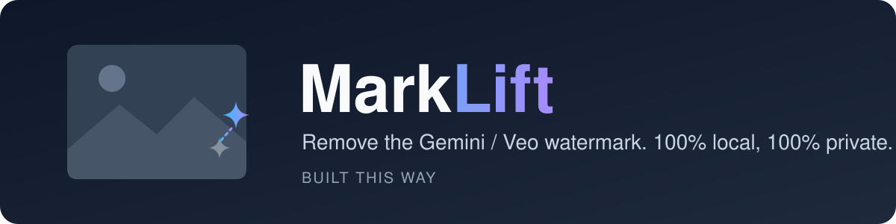

<p align="center">
  
</p>

<p align="center">
  <a href="LICENSE"></a>
  
  
</p>

# MarkLift

**MarkLift removes the visible corner watermark** (the Gemini / Nano Banana
sparkle and the Veo / Flow corner mark) from a whole folder of images and
videos, on your own computer. Nothing is uploaded anywhere.

It doesn't blur or smudge the corner. The mark is a semi-transparent logo
blended on top of the picture, and MarkLift reverses that blend, so the
original pixels underneath come back. Videos are rebuilt frame by frame and
the original audio is copied across.

> Made by **Abdul Waheed** for the **Built This Way** community.
> If this saves you time, star the repo ⭐ and share it with a friend.

---

## Quick start (Windows)

1. **Install Python 3.10+** from [python.org](https://www.python.org/downloads/)
   and tick **"Add Python to PATH"** during install.
2. **Install ffmpeg** (only needed for videos). Open a terminal and run:
   ```
   winget install Gyan.FFmpeg
   ```
3. **Download MarkLift**: click the green **Code** button above, then
   **Download ZIP**, and unzip it anywhere. Or with git:
   ```
   git clone https://github.com/abdulwaheed18/marklift.git
   ```
4. **Double-click `setup.bat`** once. It creates a private Python environment
   in the folder; nothing is installed system-wide.
5. **Put your files in the `inbox` folder** and **double-click `clean.bat`**.
   Cleaned copies appear in `inbox\cleaned\`. Your originals are never touched.

You can also drag files or folders straight onto `clean.bat`.

## Quick start (macOS / Linux)

```
git clone https://github.com/abdulwaheed18/marklift.git
cd marklift
sh setup.sh
.venv/bin/python marklift.py clean inbox
```

Install ffmpeg for videos with `brew install ffmpeg` (macOS) or
`sudo apt install ffmpeg` (Debian/Ubuntu).

---

## Works out of the box with

Ready-made masks ship in the `masks/` folder, so most people don't need to
calibrate anything:

| Source | Resolutions included |
|---|---|
| Gemini / Nano Banana images | 1200×896, 1536×2752, 2048×2048, 2752×1536 |
| Veo / Flow videos | 1280×720, 720×1280, 1920×1080, 1080×1920 |

Other sizes still work: the mark is searched at any size in the corner and
fitted to each file. A mask made at exactly your resolution is pixel-perfect,
so if a size you use gives a faint outline, see [Calibrate](#calibrate-your-own-masks).

Check what you have with `python marklift.py masks`.

## What it handles automatically

- **Any resolution.** Position, size, strength, colour and edge sharpness of
  the mark are fitted per file (for videos, over ~15 frames).
- **Several marks.** Image-to-video clips often carry the video mark *and* the
  mark baked into the start image; up to 3 marks are removed.
- **Marks that move with the scene** (a baked-in image mark while the camera
  moves or zooms) are tracked frame by frame.
- **Edited videos.** Frames without the mark (cut-aways, titles) are left
  untouched.
- **Faint outline from upscaling** (e.g. Flow's 1080p export) is detected and
  filled in.

## Command line

```
python marklift.py clean D:\exports
python marklift.py clean D:\exports -o D:\clean
python marklift.py clean img1.png img2.png clip.mp4 -j 8
```

On Windows after `setup.bat`, use `.venv\Scripts\python` in place of `python`.

- Folders are scanned recursively; images and videos can be mixed.
- Output goes to `<folder>\cleaned\` by default (or `-o`), same file names.
  Videos come out as `.mp4`.
- Already-cleaned files are skipped on re-runs (`--overwrite` redoes them).
- Files with no watermark are reported as `SKIP` and left alone.

The `OK` line shows what was found, e.g.
`[veo] 78px at (900,1740) alpha 0.31 edge 0.45 ... (mark on 144/144 frames)`.
Lower `edge` means a cleaner fit.

| Option | What it does |
|---|---|
| `-j 8` | parallel image workers |
| `--mask gemini` | use only that mask set |
| `--crf 14` | higher video quality (lower = better, bigger file) |
| `--force` | remove even if detection is unsure |
| `--box 120x120+10+10` | no-calibration fallback: inpaint bright mark pixels in a bottom-right box (W×H, then right/bottom margin) |

## Calibrate your own masks

Only needed for a resolution that isn't covered above, or if Google changes
the mark.

**Images:** in Gemini, generate *"a completely plain pure black image,
nothing else"* at the size you use and download the original PNG (not a
screenshot). A pure white one at the same size makes it even better.

```
python marklift.py calibrate black_916.png --name gemini
python marklift.py calibrate black_11.png --white white_11.png --name gemini
```

**Videos:** generate a short clip of a black screen in Veo/Flow:

```
python marklift.py calibrate black_clip.mp4 --name veo
```

On Windows you can instead put files named like `black_916.png`,
`white_916.png` or `black_veo_916.mp4` in a `calibration\` folder and
double-click `calibrate.bat`.

**No black sample?** Learn the mask from 10+ ordinary watermarked clips with
calm backgrounds:

```
python marklift.py learn clip1.mp4 clip2.mp4 clip3.mp4 --name veo
```

(or drag the clips onto `learn.bat`). Each mask saves a `.png` preview in
`masks/<name>/` so you can see what was learned.

## Self-test

```
python test_synthetic.py
```

Builds fake watermarked images and a clip, cleans them, and prints the
quality before and after (PSNR). Expect 50+ dB after on the PNGs.

## Tips

- Videos take roughly 20–60 s per short clip; more when a moving mark has to
  be tracked.
- The `--box` fallback is a smooth fill, not an exact restore. Use it only for
  marks you can't calibrate.

## Responsible use

Use MarkLift on content **you created and have the right to edit**. It
removes only the *visible* corner mark; invisible watermarks such as Google's
SynthID stay in the file. Removing a mark does not change who made the image
or what the generator's terms allow, so don't use it to pass AI content off as
real photos or footage, or to misrepresent where something came from. Follow
the platform rules where you post (many require AI content to be labelled).

## License

[MIT](LICENSE) © 2026 Abdul Waheed (Built This Way). Free to use, change and
share; keep the copyright notice.

MarkLift is an independent project, not affiliated with or endorsed by Google.
Gemini, Veo, Flow and Nano Banana are trademarks of their owners.
